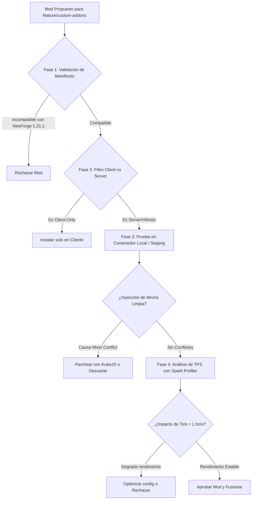

# 📋 Matriz de Mods, Compatibilidad y Auditoría — NeoForge 1.21.1

Este documento detalla el inventario de mods categorizados por paquete, su compatibilidad interna, las incompatibilidades identificadas en **Minecraft 1.21.1 (NeoForge)** y el **protocolo sistemático para analizar nuevos mods** que se propongan incorporar en el tiempo.

---

## 📑 Tabla de Contenidos

1. [Consideraciones del Loader: NeoForge 1.21.1](#1-consideraciones-del-loader-neoforge-1211)
2. [Desglose de Mods por Paquete](#2-desglose-de-mods-por-paquete)
   - [Paquete A: All The Mods 10 (ATM 10)](#paquete-a-all-the-mods-10-atm-10)
   - [Paquete B: Horror Land 2](#paquete-b-horror-land-2)
   - [Paquete C: Modded Together (Co-op Survival)](#paquete-c-modded-together-co-op-survival)
3. [Matriz de Incompatibilidades y Conflictos Críticos](#3-matriz-de-incompatibilidades-y-conflictos-críticos)
4. [Diferenciación Server-Side vs Client-Side](#4-diferenciación-server-side-vs-client-side)
5. [Protocolo de Auditoría para Nuevos Mods (Fase Temporal)](#5-protocolo-de-auditoría-para-nuevos-mods-fase-temporal)
6. [Registro Histórico de Auditorías (Changelog de Mods)](#6-registro-histórico-de-auditorías-changelog-de-mods)

---

## 1. Consideraciones del Loader: NeoForge 1.21.1

Minecraft 1.21.1 bajo NeoForge introduce cambios fundamentales frente a versiones anteriores (1.20.1 Forge):
- **Sistema de Componentes de Datos (Data Components)**: Sustituye a gran parte del sistema NBT tradicional. Mods antiguos de 1.20 no son compatibles.
- **Transición de APIs de Curios a Accessories**: Varios mods en 1.21.1 utilizan `Accessories` en lugar de `Curios API`. Se debe mantener un conector o elegir una API dominante.
- **Java 21**: Uso estricto de Java 21 LTS con soporte para recolectores modernos (ZGC / Generational ZGC o G1GC).

---

## 2. Desglose de Mods por Paquete

### Paquete A: All The Mods 10 (ATM 10)
*Enfoque: Progresión industrial, automatización, magia y dimensiones masivas.*

| Categoría | Mods Principales | Rol / Funcionalidad |
| :--- | :--- | :--- |
| **Tecnología & Redes** | Mekanism, Mekanism Generators, Applied Energistics 2, Industrial Foregoing, Powah (Rearchitected), Ender IO | Generación de energía, almacenamiento digital y procesamiento de minerales. |
| **Magia & Alquimia** | Ars Nouveau, Iron's Spells 'n Spellbooks, Mystical Agriculture, Blood Magic, Occultism | Sistemas de hechizos, cultivos de recursos y magia ritual. |
| **Generación & Dimensiones** | Terralith, Biomes We've Gone, The Twilight Forest, The Undergarden | Expansión del Overworld y mundos de exploración independientes. |
| **Almacenamiento & Logística** | Sophisticated Backpacks, Sophisticated Storage, Pipez, Functional Storage | Contenedores modulares y transporte rápido de ítems/fluidos. |
| **Rendimiento & Servidor** | ModernFix, FerriteCore, ImmediatelyFast, Chunky, Spark | Reducción del uso de RAM, optimización de tick rate y precarga de chunks. |
| **Core & Librerías** | Architectury API, Cloth Config, Resourceful Lib, Curios API / Accessories | Dependencias base transversales. |

---

### Paquete B: Horror Land 2
*Enfoque: Terror psicológico, cacería, entidades hostiles avanzadas y supervivencia inmersiva.*

| Categoría | Mods Principales | Rol / Funcionalidad |
| :--- | :--- | :--- |
| **Entidades de Terror** | The Man From The Fog, Cave Dweller Reimagined, From The Fog, Whispers of the Wendigo, Weeping Angels | Mobs con IA personalizada, persecución acústica y teletransporte. |
| **Mecánicas de Cordura & Miedo** | Sanity: Descent Into Madness, True Darkness, Insanity Mod | Degradación mental en la oscuridad, alucinaciones visuales/sonoras. |
| **Inmersión & Audio** | AmbientSounds 6, Sound Physics Remastered, Presence Footsteps | Reverberación física del sonido y efectos envolventes de pasos y cuevas. |
| **Supervivencia & Combate** | Tough As Nails (o Cold Sweat), First Aid, Better Combat | Daño localizado por extremidades, temperatura y combate fluido. |
| **Rendimiento Server** | FerriteCore, ModernFix, Entity Culling (lado cliente), Spark | Control del overhead causado por el pathfinding de IA de los monstruos. |
| **Librerías Requeridas** | AzureLib, GeckoLib 4, Kleiders Custom Renderer | Motores de animación 3D de modelos complejos. |

---

### Paquete C: Modded Together (Co-op Survival)
*Enfoque: Cooperación comunitaria, comunicación por voz, comercio y construcción.*

| Categoría | Mods Principales | Rol / Funcionalidad |
| :--- | :--- | :--- |
| **Comunicación & Teams** | Simple Voice Chat (Plasmo Voice), FTB Teams, FTB Chunks, FTB Quests | Chat de voz posicional, reclamo de parcelas y progreso conjunto. |
| **Ingeniería & Transporte** | Create (NeoForge), Waystones, Comforts (hamacas/sacos de dormir) | Automatización estética por engranajes y transporte rápido interurbano. |
| **Agricultura & Gastronomía** | Farmer's Delight, Nether's Delight, Aquaculture 2 | Expansión de cocina, cultivo y pesca relajada. |
| **Exploración & Criaturas** | Alex's Mobs, YUNG's Better Dungeons, YUNG's Better Mineshafts | Fauna interactiva y estructuras subterráneas rediseñadas. |
| **Librerías Requeridas** | Citadel (para Alex's Mobs), Forge Config API Port, Puzzles Lib | Motores base y sincronización de red. |

---

## 3. Matriz de Incompatibilidades y Conflictos Críticos

| Conflicto Identificado | Mods Involucrados | Causa Técnica | Solución / Resolución |
| :--- | :--- | :--- | :--- |
| **Colisión de Motores de Animación** | GeckoLib vs AzureLib (Horror Land 2) | Entidades que intentan registrar listeners de animación idénticos para el mismo render pipeline. | Forzar las versiones mínimas oficiales para NeoForge 1.21.1; no mezclar variantes fork no oficiales. |
| **Duplicidad de Ranuras de Accesorios** | Curios API vs Accessories | Varios mods portados a 1.21.1 esperan la API de `Accessories`, mientras otros buscan `curios:slot`. | Utilizar `Accessories` con la capa de emulación `Curios-to-Accessories Compatibility Layer` o estandarizar en un solo paquete. |
| **Saturación del Entity Ticking** | Enhanced AI / Cave Dweller vs Create | El cálculo de trayectorias complejas de mobs en áreas con máquinas en movimiento de Create degrada el TPS del servidor. | Limitar el radio de pathfinding en la configuración de IA (`config/cave_dweller.json`) y ajustar el límite de entidades por chunk. |
| **Incompatibilidad de Gráficos en Servidor** | OptiFine / Rubidium heredado | OptiFine rompe el servidor dedicado e introduce bugs de desincronización de paquetes con NeoForge. | **Prohibido en el servidor.** Se usa `Embeddium` / `Sodium` en clientes y optimizadores puros en servidor (`ModernFix`). |
| **Puerto UDP para Voz** | Simple Voice Chat (Modded Together) | El chat de voz opera en un puerto UDP independiente al 25565 de Minecraft. En Azure/Pterodactyl, si no está abierto el puerto UDP, el plugin falla. | Asignar una regla de puerto adicional en el Panel Pterodactyl (ej. `24454 UDP`) y en el Network Security Group (NSG) de Azure. |

---

## 4. Diferenciación Server-Side vs Client-Side

Es fundamental **no cargar mods exclusivos de cliente en el servidor dedicado**, ya que causan `ClassNotFoundException` inmediata al arrancar.

### Mods Exclusivos de Cliente (NO incluir en el servidor):
- `Iris / Oculus` (Sombreadores / Shaders)
- `Sodium / Embeddium` (Renderizado gráfico de pantalla)
- `Presence Footsteps` (Efectos de audio locales del jugador)
- `ImmediatelyFast` (si está en modo client-only)
- `Controlling` (Búsqueda de teclas en el menú de opciones)
- `Just Enough Items (JEI)` / `REI` (Aunque tienen módulo server opcional, su núcleo es visual)

### Mods Exclusivos o Críticos de Servidor:
- `Chunky` (Generación de mapa en reposo)
- `Spark` (Profiler de rendimiento)
- `FTB Chunks` (Protección y forzado de carga de chunks)
- `Connectivity` (Optimización de timeouts de conexión en Azure)

---

## 5. Protocolo de Auditoría para Nuevos Mods (Fase Temporal)

Cuando se proponga agregar un mod nuevo a la rama `feature/custom-addons`, debe seguirse obligatoriamente este checklist de 5 fases:



### Checklist Detallado:

1. **Fase 1 — Análisis Estático de Dependencias**:
   - Verificar en `neoforge.mods.toml` que declare soporte explícito para Minecraft `1.21.1` y la versión de NeoForge en uso.
   - Constatar que no requiera Fabric API o Forge Legacy sin conector.

2. **Fase 2 — Clasificación de Entorno**:
   - Verificar si el mod define `@OnlyIn(Dist.CLIENT)` en clases que el servidor intente instanciar.
   - Si es un mod puramente cosmético o de interfaz, no debe subirse al servidor de Pterodactyl.

3. **Fase 3 — Detección de Colisiones de Mixin**:
   - Iniciar el servidor en modo depuración.
   - Revisar `logs/debug.log` buscando advertencias del tipo:
     `Mixin apply failed ... target class already transformed by ...`
   - Si dos mods modifican la misma línea del loop principal de entidades (`ServerLevel.tick`), se producirá desincronización o crash.

4. **Fase 4 — Prueba de Carga y Profiling (Spark)**:
   - Ejecutar en consola:
     ```text
     /spark profiler start --timeout 300
     ```
   - Realizar actividades intensivas (explorar chunks nuevos, generar combate con entidades de horror, automatizar máquinas).
   - Detener el profiler con `/spark profiler stop` y analizar el informe web:
     - Ningún mod individual debe consumir más del **8%** del tiempo total de tick del servidor en condiciones normales.

5. **Fase 5 — Evaluación Temporal a 7 Días**:
   - Monitorear el consumo de memoria en la VM de Azure tras 7 días de juego continuo:
     - Revisar posibles fugas de memoria (Memory Leaks) producidas por entidades que no descargan su memoria al descargarse los chunks.

---

## 6. Registro Histórico de Auditorías (Changelog de Mods)

Utiliza este formato para documentar cada adición o cambio en las ramas correspondientes:

```markdown
### [YYYY-MM-DD] - Nombre del Mod (Versión)
- **Rama objetivo**: `feature/custom-addons` / `modpack/atm10` / etc.
- **Autor / Repositorio**: Enlace a Modrinth o CurseForge
- **Estado**: [Aprobado / En Observación / Rechazado]
- **Dependencias agregadas**: Librería A, Librería B
- **Impacto de TPS medido (Spark)**: +0.4ms por tick
- **Observaciones**: Requiere ajustar `spawn_rate` en `config/mod.json` para evitar saturación.
```
