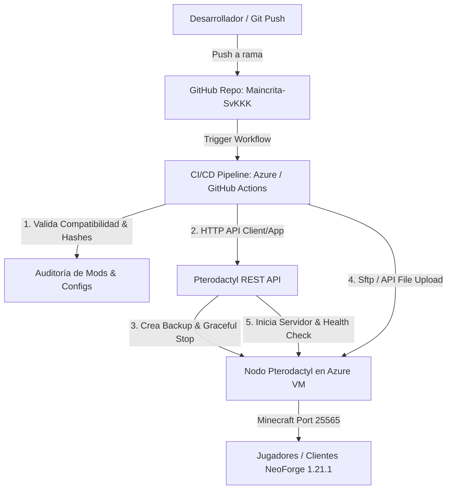

# 🎮 Maincrita-SvKKK — Servidor Minecraft NeoForge 1.21.1

Infraestructura y gestión centralizada para el servidor multimodpack de **Minecraft Java Edition (NeoForge 1.21.1)**, alojado en **Microsoft Azure** y sincronizado mediante un pipeline de CI/CD conectado a la **API de Pterodactyl**.

---

## 📌 Tabla de Contenidos

- [Visión General](#visión-general)
- [Arquitectura de Infraestructura](#arquitectura-de-infraestructura)
- [Estrategia de Ramas (Git Branching Model)](#estrategia-de-ramas-git-branching-model)
- [Modpacks Considerados](#modpacks-considerados)
- [Pipeline de CI/CD y API de Pterodactyl](#pipeline-de-cicd-y-api-de-pterodactyl)
- [Gestión y Auditoría de Compatibilidad de Mods](#gestión-y-auditoría-de-compatibilidad-de-mods)
- [Configuración del Servidor y Java](#configuración-del-servidor-y-java)
- [Guía de Contribución](#guía-de-contribución)

---

## 🚀 Visión General

El propósito de este repositorio es desacoplar y estandarizar la configuración del servidor de Minecraft para alternar entre diferentes experiencias de juego (modpacks) sin comprometer la integridad de los mundos ni requerir reconfiguraciones manuales propensas a errores.

- **Motor / Loader**: [NeoForge](https://neoforged.net/) `1.21.1`
- **Java Runtime**: Java 21 LTS (OpenJDK / Eclipse Temurin)
- **Host**: Instancia Virtual en **Microsoft Azure**
- **Panel de Control**: **Pterodactyl Panel**

---

## ☁️ Arquitectura de Infraestructura



1. **Alojamiento en Azure**:
   - Máquina virtual optimizada para cómputo en Microsoft Azure (Series D o Bv2 recomendadas para servidores modded).
   - Disco SSD Premium / Ultra para minimizar el tiempo de I/O en la carga y generación de chunks.
2. **Panel Pterodactyl**:
   - Administra el contenedor Docker con aislamiento de recursos (CPU, RAM, Swap).
   - Expone endpoints REST para automatizar respaldos, envío de comandos a la consola y control del ciclo de vida del proceso (`start`, `stop`, `restart`, `kill`).

---

## 🌿 Estrategia de Ramas (Git Branching Model)

El repositorio utiliza ramas dedicadas para separar los entornos y configuraciones de cada modpack:

| Rama | Propósito | Estado / Loader |
| :--- | :--- | :--- |
| `main` | Rama base estable. Contiene plantillas de servidor, scripts de pipeline y documentación global. | Base |
| `modpack/horror-land-2` | Configuración, mods y scripts de **Horror Land 2** adaptado a 1.21.1. | En desarrollo |
| `modpack/atm10` | Configuración, mods y optimizaciones para **All The Mods 10 (ATM 10)**. | En desarrollo |
| `modpack/modded-together` | Configuración de **Modded Together** (primeras versiones adaptadas a 1.21.1). | Planificado |
| `feature/custom-addons` | Espacio de pruebas para nuevos mods sugeridos a lo largo del tiempo antes de fusionarse. | Activa |
| `fix/patches` | Corrección de incompatibilidades, hotfixes de rendimiento, ajustes de KubeJS y parches de configuración. | Soporte continuo |

---

## 📦 Modpacks Considerados

Para conocer la lista completa, análisis de compatibilidad cruzada y reglas de integración de cada paquete, consulta el documento central:
👉 **[MODS_COMPATIBILITY.md](./MODS_COMPATIBILITY.md)**

1. **Horror Land 2 (NeoForge 1.21.1)**:
   - Experiencia de terror psicológico y supervivencia inmersiva.
   - Enfoque: Entidades inteligentes (The Man From The Fog, Cave Dweller), gestión de cordura, audio posicional 3D y niebla atmosférica.
2. **All The Mods 10 - ATM 10 (NeoForge 1.21.1)**:
   - Modpack de progresión masiva "kitchen-sink".
   - Enfoque: Gran integración técnica (Mekanism, AE2, Powah), magia (Ars Nouveau, Iron's Spells) y dimensiones con quests extensas.
3. **Modded Together (Primeras Versiones / Co-op Survival)**:
   - Experiencia cooperativa ligera enfocada en comunidad, exploración y construcción en equipo.
   - Enfoque: Simple Voice Chat, FTB Teams/Quests, Waystones, Farmer's Delight y Create.

---

## ⚙️ Pipeline de CI/CD y API de Pterodactyl

El despliegue está automatizado para interactuar directamente con la API del panel Pterodactyl:

### Variables Secretas Requeridas en el Repositorio

- `PTERODACTYL_URL`: URL base de la instancia del panel (ej. `https://panel.tudominio.com`).
- `PTERODACTYL_API_KEY`: Client API Key generada en el panel de Pterodactyl (permisos de servidor).
- `PTERODACTYL_SERVER_ID`: Identificador UUID o corto del servidor de Minecraft.

### Flujo de Ejecución del Pipeline:

1. **Checkout & Matriz de Validación**: Comprueba la integridad de los archivos de configuración (`.toml`, `.json`, `.snbt`).
2. **Creación de Respaldo**:
   ```http
   POST /api/client/servers/{server_id}/backups
   ```
3. **Notificación & Apagado Elegante (Graceful Shutdown)**:
   Envía comandos por consola anunciando el mantenimiento a los usuarios conectados y detiene el servidor de forma segura:
   ```http
   POST /api/client/servers/{server_id}/command
   Body: {"command": "say [SERVIDOR] Iniciando sincronización de mods y configs. Reinicio en 30s..."}
   
   POST /api/client/servers/{server_id}/power
   Body: {"signal": "stop"}
   ```
4. **Sincronización de Archivos**: Sube y reemplaza carpetas `config/`, `defaultconfigs/`, `kubejs/` y la lista de mods.
5. **Reinicio y Monitoreo**:
   ```http
   POST /api/client/servers/{server_id}/power
   Body: {"signal": "start"}
   ```

---

## 🔍 Gestión y Auditoría de Compatibilidad de Mods

Para evitar crashes y degradación del TPS (Ticks Per Second) a lo largo del tiempo:

- Todo nuevo mod que se planee incorporar debe pasar primero por la rama `feature/custom-addons`.
- Se debe registrar en [MODS_COMPATIBILITY.md](./MODS_COMPATIBILITY.md) especificando:
  - Nombre del mod y versión exacta para NeoForge 1.21.1.
  - Dependencias de librerías requeridas (ej. Architectury, Curios, AzureLib).
  - Estado de compatibilidad con mods de rendimiento (Embeddium, ModernFix, FerriteCore).
  - Impacto en el tick del servidor medido con **Spark Profiler**.

---

## ☕ Configuración del Servidor y Java

### Parámetros de JVM Recomendados (Aikar's Flags optimizados para NeoForge 1.21.1)

```bash
java -Xms8G -Xmx8G \
  -XX:+UseG1GC \
  -XX:+ParallelRefProcEnabled \
  -XX:MaxGCPauseMillis=200 \
  -XX:+UnlockExperimentalVMOptions \
  -XX:+DisableExplicitGC \
  -XX:+AlwaysPreTouch \
  -XX:G1NewSizePercent=30 \
  -XX:G1MaxNewSizePercent=40 \
  -XX:G1ReservePercent=20 \
  -XX:G1HeapWastePercent=5 \
  -XX:G1MixedGCCountTarget=4 \
  -XX:InitiatingHeapOccupancyPercent=15 \
  -XX:G1MixedGCLiveThresholdPercent=90 \
  -XX:G1RSetUpdatingPauseTimePercent=5 \
  -XX:SurvivorRatio=32 \
  -XX:+PerfDisableSharedMem \
  -XX:MaxTenuringThreshold=1 \
  -Dusing.aikars.flags=https://mcflags.emc.gs \
  -Daikars.new.flags=true \
  -jar neoforge-server.jar nogui
```

---

## 👥 Guía de Contribución

1. Crea tu rama desde la rama del modpack correspondiente (o desde `feature/custom-addons`).
2. Realiza commits atómicos y descriptivos siguiendo la convención [Conventional Commits](https://www.conventionalcommits.org/):
   - `feat(mods): agregar mod X para resolver Y`
   - `fix(config): corregir conflicto de IDs en biomas`
   - `perf(server): optimizar render distance y chunk loading en neoforge.cfg`
3. Abre un Pull Request describiendo los cambios y los resultados de las pruebas locales.
